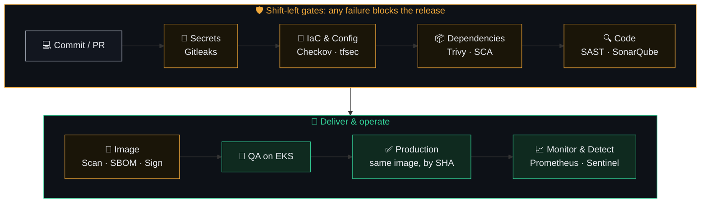

<div align="center">



<br /><br />

<a href="https://omajuwaokotie.com"></a>
<a href="https://www.linkedin.com/in/omajuwa-okotie-850950190"></a>
<a href="mailto:okotieomajuwa2016@gmail.com"></a>


</div>

<br />

## `$ whoami`

I build security into how software is shipped.

Over five years building and deploying software, including over three years focused on DevSecOps and cloud security across AWS and Azure. I design CI/CD pipelines where security checks **block** a bad release instead of just reporting it, harden cloud infrastructure in Terraform, deploy hardened workloads to Amazon EKS, and build detection and response that works when it matters.

My background as a full-stack engineer means I understand the applications I secure, not just how to scan them. MSc Computer Forensics and Cybersecurity with **Distinction**, University of Greenwich.

<br />

## `$ cat security-scorecard.md`

| Metric | Before | After | Project |
| --- | :---: | :---: | --- |
| Terraform security findings (Checkov) | 72 | **0** | SecureFlow |
| Known dependency vulnerabilities | 25 | **0** | SecureX |
| Test coverage in SonarQube | 0% | **86.3%** | SecureX |
| Security gates that block a release | 0 of 4 | **4 of 4** | SecureX |
| Credential compromise detection to response | 4+ hours | **< 5 min** | Sentinel |
| Stored cloud credentials in CI/CD | Access keys | **None (OIDC)** | SecureX |

<br />

## `$ ./how-i-ship.sh`



<br />

## `$ ls ~/toolbox`

<table>
<tr>
<td valign="top" width="24%"><b>Cloud &amp; IaC</b></td>
<td>


</td>
</tr>

<tr>
<td valign="top"><b>Containers &amp; Orchestration</b></td>
<td>


</td>
</tr>

<tr>
<td valign="top"><b>CI/CD &amp; DevSecOps</b></td>
<td>


</td>
</tr>

<tr>
<td valign="top"><b>Identity &amp; Secrets</b></td>
<td>


</td>
</tr>

<tr>
<td valign="top"><b>Detection &amp; Observability</b></td>
<td>


</td>
</tr>

<tr>
<td valign="top"><b>AppSec &amp; Testing</b></td>
<td>


</td>
</tr>

<tr>
<td valign="top"><b>Languages</b></td>
<td>


</td>
</tr>

<tr>
<td valign="top"><b>Frameworks</b></td>
<td>


</td>
</tr>
</table>

<br />

## `$ git log --featured`

> **`PLATFORM-SEC`** &nbsp; **[SecureX](https://github.com/omjhub/SecureX)** &nbsp; 
> ### Production-grade DevSecOps platform on Amazon EKS
> - **14-job pipeline** where Gitleaks, Checkov, Trivy and SonarQube all block a release, each proven with a deliberate failure
> - Dependency CVEs **25 → 0**, test coverage **0% → 86.3%** with 31 Jest and Supertest tests
> - Separate QA and production; production runs the **exact image QA tested**, promoted by SHA with **7 required checks**
> - **No stored cloud keys**: GitHub OIDC, Secrets Manager, External Secrets Operator and IRSA
>
> `Amazon EKS` `GitHub Actions` `GitHub OIDC` `IRSA` `Trivy` `SonarQube` `Syft`

> **`PIPELINE-SEC`** &nbsp; **[SecureFlow](https://github.com/omjhub/SecureFlow-VulnerableCodebase)** &nbsp; 
> ### Secure CI/CD pipeline for a banking platform
> - Seven-stage pipeline securing a vulnerable banking microservices codebase
> - Terraform findings **72 → 0**; a live pull request automatically blocked on **275 findings**
>
> `Gitleaks` `Trivy` `Checkov` `HashiCorp Vault` `OPA Gatekeeper` `Falco`

> **`APPSEC-LEAD`** &nbsp; **[SentinelPay](https://github.com/sentinelpay-team/Sentinelpay)** &nbsp; 
> ### Securing an inherited fintech platform
> - Led threat modelling and remediation of SQL injection, JWT bypass, IDOR and a race condition, each proven with a before-and-after exploit
> - CI/CD gates and supply chain controls (CycloneDX SBOMs, Cosign signing) ahead of a timed attack simulation
>
> `STRIDE` `Semgrep` `Bandit` `tfsec` `GuardDuty` `Cosign`

> **`CLOUD-INFRA`** &nbsp; **[VaultBridge](https://github.com/omjhub/vaultbridge-iac-modernisation)** &nbsp; 
> ### Three-tier AWS infrastructure as code
> - Fixed the root cause of a **$214,000** incident in the client brief
> - Security-group-only database access and a validation rule rejecting any SSH rule broader than /32
>
> `Terraform` `AWS` `tfsec` `Checkov`

> **`DETECTION`** &nbsp; **[Cloud Threat Detection](https://github.com/omjhub/cloudscale-sentinel-soc-poc)** &nbsp; 
> ### SIEM/SOAR with Microsoft Sentinel
> - Detection-to-response cut from **4+ hours to under 5 minutes**
> - Custom KQL rule debugged through live testing; Logic Apps playbook firing within **13 seconds**
>
> `Microsoft Sentinel` `KQL` `Logic Apps` `Entra ID`

> **`RESEARCH`** &nbsp; **[Web Vulnerability Detection](https://github.com/omjhub/Detecting-Vulnerabilities-In-Web-Applications)** &nbsp; 
> ### Extending OWASP ZAP detection granularity
> - Baseline differential response verification on top of ZAP
> - Two of three false negatives turned into confirmed true positives with **zero new false positives**
>
> `Python` `OWASP ZAP` `DVWA` `Juice Shop`

<br />

## `$ history | grep work`

<table>
<tr>
<td valign="top" width="24%"><b>Jul 2023 to Oct 2026</b><br /><sub>AMDARI (Remote, Part-time)</sub></td>
<td valign="top"><b>Cloud Security Specialist (DevSecOps &amp; Cloud Security Engineer)</b><br />Secure CI/CD, infrastructure as code security, cloud threat detection and team-led vulnerability remediation across AWS and Azure, delivering SecureFlow, VaultBridge, Cloud Threat Detection and SentinelPay end to end from industry client briefs.</td>
</tr>
<tr>
<td valign="top"><b>Jan 2024 to Jun 2024</b><br /><sub>Spashisha (Remote, Part-time)</sub></td>
<td valign="top"><b>Software Engineer</b><br />Developed and deployed cloud-based applications, configuring cloud hosting, environment settings and release processes, with automation and security enhancements to deployments.</td>
</tr>
<tr>
<td valign="top"><b>Aug 2021 to Oct 2023</b><br /><sub>LinkX (Self-employed)</sub></td>
<td valign="top"><b>Project Lead / Mobile App Developer</b><br />Led design, development and deployment of mobile and web applications, and mentored team members in Flutter/Dart and backend best practices.</td>
</tr>
</table>

<br />

<div align="center">

```bash
$ echo "Open to DevSecOps, Cloud Security and AppSec Engineer roles in the UK. Available immediately."
```

<a href="https://omajuwaokotie.com">omajuwaokotie.com</a> &nbsp;·&nbsp; <a href="mailto:okotieomajuwa2016@gmail.com">okotieomajuwa2016@gmail.com</a> &nbsp;·&nbsp; <a href="https://www.linkedin.com/in/omajuwa-okotie-850950190">LinkedIn</a>

</div>
